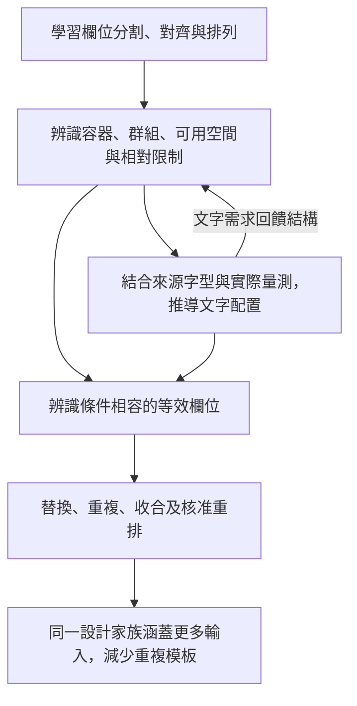

# 欄位結構、文字配置與等效欄位的共同學習（已確認設計原則）

- 日期：2026-10-18。
- 狀態：USER_CONFIRMED_DESIGN_PRINCIPLE。使用者已確認本次因果說明並明確要求持久化，作為設計學習參數或模型的依據。
- 範圍：確認學習方向與推導依賴；參數schema／模型技術為待實作設計，不表示模型已訓練或功能已驗證。不改UI-013固定字級、分散語意政策、UI-061／062、字型／Logo／正式輸出Gate。
- 連結：[主方案](../dev/AI_CROSS_WORK_LEARNING_PLAN.md)、[有效契約](../dev/AI_CROSS_WORK_LEARNING_CONTRACT.json)、[四類風格與整合對帳](../dev/CARD_INTERFACE_STYLE_LEARNING_REVIEW.md)。

## 1. 使用者原意與確認

使用者：「邏輯是這樣的，學習欄位的分割、對齊與排列，有助於了解該欄的大小與字寬縮放、字級大小、分散對齊方式，還有助於找出等效欄位，讓資料排列更靈活，也能精簡模板數。」

在說明下述因果關係後，使用者確認：「正確，我需要將這個討論持久化進github，作為設計學習參數或模型的依據」。此確認不代表授權任意縮字、恢復客戶文字尺度控制或放寬正式Gate。

## 2. 確認的因果關係

1. **結構解釋空間**：分割、對齊與排列揭示人物區／公司區／聯絡區、容器邊界、共用對齊線、群組依賴與可擴展空間。區分來源可見框、文字實際占用範圍及推定可用空間，不把空白一律當可任意挪用。
2. **空間與文字互相約束**：可用寬高結合實際字型、pt、自然字形advance、tracking、ScaleX及分散模式，共同解釋作品的文字配置；文字所需空間也會影響分欄、換列或群組擴展。簡化寬度關係為 `width_used=ShapeAdvance(font,pt,text,tracking)×scale_x`，實際仍以同一正式文字布局量測／繪製驗證。
3. **相容條件產生等效欄位**：結構、語意、所有權、文字容量及核准政策共同定義可替換範圍，不能只靠框寬高或字串相同判定。
4. **等效欄位與可變文法提高彈性**：同一家族在條件成立時替換欄位、repeat新增資料、optional收合缺項或合法reflow；每次替換保留資料ID／歸屬及客戶明確關係，重新驗證。
5. **共用規則減少重複模板**：兩筆電話、三筆電話、電話加Email等內容變化可由同一家族規則生成；家族間確有不同的設計仍保留差異。不可為了壓縮模板數強併不相容作品。

這是計算上的推導依賴與聯合辨識，不是已用實驗證明原設計師決策的單向因果。單一框寬不能唯一辨識字級；不同字型、pt、tracking或ScaleX都可能產生相近外框。來源缺失維持UNKNOWN／估計，不以預設10pt當真值。

## 3. 對參數與模型的具體約束

四組風格特徵共享同一觀察、家族、條件文法與文字量測：

| 特徵組 | 需記錄的內容 | 在模型中的用途 |
|---|---|---|
| 結構與空間 | 容器樹、人物／公司角色、群組、欄列、框與ink bounds、padding/gutter、baseline、錨點、鄰接與可變範圍 | 家族特徵、可用空間假說、關係約束 |
| 文字配置 | font face/hash、真實pt、角色字級比例、glyph/cluster與自然advance、ScaleX、tracking、分散單位／邊界、行流 | 解釋來源風格、條件偏好及正式實測 |
| 等效性 | 允許角色／資料種類、所有權約束、群組／對齊關係、容量、資產／文字政策版本 | 形成可替換角色類別及逐輸入可行性判定 |
| 可變文法 | optional/repeat、欄位替換、收合、擴展、合法reflow及適用條件 | 由共用規則生成新資料組合，避免每案一模板 |
| 證據 | 來源hash／變換、量測可信度、獨立lineage支持、誤差／反例、版本 | 判定能否學習、外推與啟用，不將相似當已核准 |

**等效性分兩層**：

- 結構角色相容：用途／允許資料種類、所有權規則、群組關係和政策相容，才成為可替換候選。
- 當次綁定可行：替入實際文字、實際字型及核准配置後，重新檢查容量、完整性、可讀性、安全區、不重疊與所有權；通過後才能採用。相同尺寸不代表相容，角色相容也不保證每個字串都能放下。

例如：都允許手機／市話的兩個聯絡角色可能相容；姓名框即使同樣大也不因此等效。Email必須被角色政策允許並通過當次量測。交換顯示位置不轉移主人、不合併同字串的兩筆資料。

模型管線沿用主方案：有證據的來源觀察→結構／文字共同特徵→跨作品家族→條件規則／等效角色→有限拓撲與真實量測→既有Kiwi／正式Gate→偏好排序。推導可在有界搜尋中回饋重排；不以反覆選更小字級候選繞過固定pt，不以循環求解無限嘗試。

## 4. 實作與驗證接點

- AI-LEARN-01：同時保存結構／空間與文字證據，分清觀察、估計與預設。
- AI-LEARN-02／03：以共同特徵學家族、條件規則與等效角色；保留反例／獨立支持。不能只按框位聚類。
- AI-LEARN-04：當次綁定驗證、替換／repeat／optional／reflow、資料完整性及既有Gate；正式實例不自動寫成全域模板。
- AI-LEARN-08：真實授權heldout比較「固定逐作品框位」與「結構＋文字＋條件等效」；以新組合可行率、硬錯誤、資料保留、獨立偏好與家族壓縮共同評估，不能只獎勵模板數變少。去重lineage、封存TEST及失敗分母沿用原方案。

補充案例：同框不同字型／pt不可硬推唯一字級；同幾何姓名／電話不可互換；相容聯絡角色需對長Email重驗；兩筆／三筆聯絡資料可共用家族；資料缺項收合不刪其他欄位；不相容家族不能強併。這些是原50條驗收的細化案例，尚未執行，不增加完成數。

本次只保存已確認設計原則、機器可讀參數依據及接續入口。仍8工作包／50規劃驗收，0實作／0驗證；既有75父題／CORE／GOV狀態不變。
