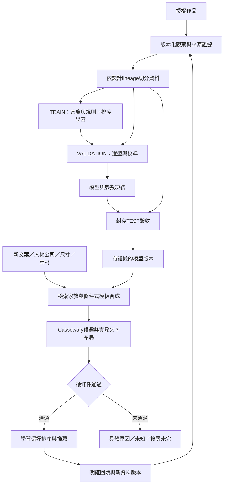

# Template AI：跨作品規則學習、模板合成與輸入條件排版

2026-10-17。產品目標已由使用者確認；以下工程方案、數字與門檻是具體建議，尚未實作或實測。新契約8工作包／50規劃驗收（原36＋風格與整合14），0實作、0執行、0通過。CURRENT008的1549個既有測試只證明原登錄流程，不能證明本目標完成。

## 1. 完成目標與禁止替代品

目標：匯入多份作品 -> 觀察設計結構 -> 學出共用家族／可變規則 -> 形成參數化模板模型 -> 接受新文案、人物／公司與成品尺寸 -> 找出合適家族並合成候選 -> 求解與排序 -> 顯示／輸出驗證後的結果。

一份作品是一個訓練觀察，不自動等於一份輸出模板。新的主訓練流程不再對每份作品呼叫`_write_geometry_draft`。舊逐作品模板只保留明確的歷史還原／手工保存相容功能，不作新學習成果數量。樣本不夠的孤例保留為未歸類觀察，不偷偷變成「學成模板」。

核心成果是版本化的「設計家族＋規則模型」，不是原稿座標清單。一次新輸入可編譯成暫態版面實例；只有明確收藏／保存版本才進入傳統模板庫，避免每次輸入再累積一份模板。正常介面為匯入、學習進度／家族、輸入、推薦／新排版；人工只處理低可信觀察與代表性偏好抽查。

必須證明：多份獨立作品共同影響同一規則；新輸入可以產生原庫不存在的欄位組合與適用尺寸實例。僅選取一份原作品、改字或複製座標不能通過本目標。

## 2. 數學、AI與現成元件的分工

TEST是封存驗收，不反饋同一版調參；曝光後的後續訓練須另建角色／封存版本。

| 問題 | 方案 | 數學／訓練依據 | 重用來源 |
|---|---|---|---|
| 讀取作品 | 向量物件、實際字型、文字與圖形分層；必要時OCR | 座標變換、文字成形量測、來源信心 | 既有Inkscape、fontTools、Qt、來源／語意辨識 |
| 跨作品找風格家族 | 結構相容分組後HDBSCAN；孤例不強併 | 正規化特徵、密度與群聚穩定性 | scikit-learn1.7.2 HDBSCAN（BSD-3-Clause） |
| 學出共同版面規則 | 語意群組圖、重複／可選區塊、median/MAD；資料足夠時RANSAC擬合尺寸與位置關係 | 穩健統計、條件回歸、可組合規則文法 | NetworkX3.5、scikit-learn RANSAC；現有型別／欄位模型 |
| 為新輸入生成模板 | 從已學規則選群組拓撲、實例化欄位，求連續幾何 | 有限拓撲搜尋＋Cassowary軟／硬約束 | 既有kiwisolver1.4.9／CustomLayout；需移除僅依單一來源框位的限制 |
| 選擇最佳候選 | 硬條件先過濾，再以偏好模型評分 | query分組的pairwise learning-to-rank | CatBoost1.2.8 Ranker／PairLogit（Apache-2.0） |
| 工業排版參數 | 群組、水平／垂直流向、包裹、固定／自動大小、間距／padding | 容器與子物件的約束分工 | Figma官方公開plugin類型（MIT），參考Auto Layout思想，不使用付費API |
| 更複雜的生成研究 | 條件生成／補全／細修與關係約束實驗 | 離散擴散等條件式布局生成 | LayoutDM官方CVPR2023實作（Apache-2.0），研究參照，非第一版必要依賴 |

第一版主線選「跨作品分群＋可學習規則文法＋條件合成＋學習排序」，CPU即可做基準，不將大型語言模型API或GPU租用列為必要條件。LayoutDM的公開環境是Python3.7／PyTorch1.10／CUDA11.3，不能直接塞進本專案Python3.12環境；僅研究條件生成思路，後續如有必要另做相容與效益評估。其程式授權不等於Rico／PubLayNet資料或模型權重授權。

官方來源版本、commit、文件SHA與實際查閱範圍見`AI_CROSS_WORK_ENGINEERING_REFERENCES.json`。已讀Figma公開定義；Adobe Liquid Layout頁面／API目前未成功讀取，不能冒稱查閱或以其為已驗證依據。沒有複製商用私有演算法。

## 3. 可學習資料與樣本切分

### 3.1 DesignObservation

每個作品觀察保存：source內容hash／頁／作品ID／版本、來源變換、實體W/H、design_lineage_group、用途授權、原稿可讀性、欄位／群組圖、字型／文字／圖形證據、缺失與信心。每欄位保存semantic_type、人物／公司關係、原始及正規化rect、文字成形寬高、baseline、font_file_hash/face/style/pt、字距、對齊、顏色及各值來源。

來源值分`MEASURED / SOURCE_DECLARED / ESTIMATED / UNKNOWN / HUMAN_CONFIRMED`；不得將Slot的10pt／Noto預設當原稿真值。向量來源先解析繼承樣式與變換；只有可證明的均勻縮放才能換算pt。非等向變換、轉曲與點陣字型無法可靠還原時保留估計／未知。字形高度不能直接當字級。未知字型不得混入已核實字型訓練標籤；可另以已授權的字型政策生成，但不能冒稱原稿字型。

座標正規化：u=x/W、v=y/H、a=w/W、b=h/H；同時保留mm與pt。對齊、群組間距、文字層級、留白比例等大部分由量測自動計算，不要求使用者逐作品填參數。輸入文字只做角色／長度／成形寬度等必要特徵；不把姓名、客戶ID或檔名當風格家族捷徑。

裝飾層必須區分`STATIC_DECORATION / DYNAMIC_TEXT / WHOLE_LOGO / UNKNOWN`。不可把含舊姓名／電話的整張點陣原稿當新模板背景。原始素材不改寫；無法可靠分層的資料保留待處理，不能當可自由重排的乾淨模板。完整Logo保持整體與比例，歸屬／來源／指定尺寸／用途仍走既有核驗。

### 3.2 資料角色

沿用現有SAMPLE／DATASET／TrainingStore，而非另建資料庫。精確重複去重；近重複、同作品改版、同客戶重排等建立lineage群組。一次訓練的manifest凍結觀察ID／版本／hash、授權、角色與資料切分。

起始切分建議TRAIN/VALIDATION/TEST=70/15/15，按lineage群組切分，必要時按專案／設計來源做更嚴格分組。不能只按單一檔案切分：一個檔案可含多個獨立作品，也可能多個檔案是同一作品改版。分群、標準化、規則估計與模型調參只接觸TRAIN；VALIDATION用於選型／校準；封存TEST只驗收。TEST曝光、人工回饋或來源修訂後要另建封存版本。

兩種泛化分開報告：A已知家族的新作品／文案／尺寸；B未見家族／不支援設計。B允許明確拒答或探索預覽，不把未知風格硬套成高可信正式結果。合成資料只驗證機制；真實作品、字型、原生AI視覺一致及指定實機效能需要真實證據。

## 4. 家族與規則如何真正從資料學出

### 4.1 DesignFamily

以人物／公司群組、文字角色集合、群組方向與拓撲等做相容性描述，再對連續幾何／間距／文字層級特徵做穩健縮放與HDBSCAN。可變電話／Email數量先抽象為重複群組，不能用完全相同的欄位數把所有作品切成孤島。背景色、裝飾等可參與風格特徵，姓名內容、來源ID不得參與分群。

起始`min_cluster_size=5`、`min_samples=3`，正式家族至少5個去重後設計lineage支持；這些是待驗證預設，不是成功保證。重複匯入100份同作品不能湊足5。保留noise與不確定成員，不能靠強制合併湊出漂亮壓縮率。孤例也能提供有證據的群組局部規則，但不足支持的整體家族不得冒充已學成。

HDBSCAN沒有本方案可直接依賴的partial_fit／任意query預測介面；新增作品先增量抽特徵，再依凍結批次重估家族版本。成員對應用相容原型／medoid與驗證過的距離界線；家族ID依歷史成員關係對應，不能把每次cluster數字當永久身份。推論檢索新輸入是依家族能力／條件索引，不把沒有版面座標的新文案丟進原稿分群器當預測。

### 4.2 RuleModel

學習的主要是「姓名群組靠左上、職稱在姓名下、聯絡區垂直堆疊、群組共用左邊界、Logo與公司歸屬、哪些區塊可省略／重複」等結構，以及尺寸／內容改變時的條件位置與間距。保存每條規則的支持／反例、有效樣本數、版本與適用範圍。

群組圖節點可為entity/group/field/decorative layer，關係包含align-left/center/right、below、baseline、gap、repeat、optional、flow、wrap、anchor及aspect。先從候選關係聚合，按角色／群組類型支持率與反例選擇，不對所有作品的所有物件做無界圖比對。缺失欄位只能學成可選／未知，不視為該資料不需要呈現。

連續參數用median與MAD估計穩定中心／離散程度；分位區間是軟偏好／候選範圍，不自動變成安全硬限制。條件擬合起始要求至少20個獨立設計lineage及至少3個不同尺寸條件，殘差界線可先試TRAIN的2.5×MAD加量測精度底線；這些仍需VALIDATION檢查。只有多尺寸／內容變化足夠時才用RANSAC或線性條件模型擬合位置、間距與尺寸的關係；資料不足保留常數／未知，不拿單尺寸樣本外推任意成品。

三種權限明確分離：
1. 硬政策：實體邊界、使用者設定安全邊距、完整資料、固定字級規則、字型／Logo授權、鎖定；模型不能自行解除。
2. 學到的軟偏好：相對位置、間距、字級層級、群組拓撲的頻率與適用範圍。
3. 執行設定：搜尋預算、並行、資源與取消；不當設計品質參數。

字級階層可從作品學出候選風格組合；一旦選定當次候選的字級，其內容適配仍遵守既有固定pt／字寬下限，不因長文偷偷縮字級。

## 5. 根據新輸入合成與選擇結果

輸入包含目標W/H、人物／公司關聯、欄位與數量、文字成形寬度、可用字型／Logo與用途、可選風格偏好。先索引家族能力，選top-K家族；依已學repeat/optional/flow文法實例化當次物件圖，再產生有限拓撲候選，最後解連續幾何。

每個拓撲的目標可表示為：

`min Σ w_i * |p_i - μ_family(input)| + λ_gap * Σ |gap_e - ĝ_e(input)| + λ_style * style_deviation`

硬條件另列：物件位於成品／政策邊距內、必要資料全數有框、人物／公司歸屬正確、文字實測可放、字寬縮放不少於核准下限、允許換行的欄位不超過行數／高度、Logo比例／來源合格、鎖定與用途限制成立。非重疊是離散選擇；由已學拓撲的方向／順序或有限分支選定，再交Cassowary，並在產出後對所有物件重新檢查。不能宣稱Cassowary單獨能解任意非凸排版。

多行文字必須新增可驗證的文字flow資料：Qt文字布局使用與輸出完全相同的字型、字級、行距與斷行。先支援有證據的地址／職稱換行；姓名／Email／電話／社群ID維持明確的不可任意斷開規則。不得插入假換行來截斷資料，不能以量測一套、實際繪製另一套通過。

先過硬Gate，再比較有限候選。資料不足時以明確的幾何偏好基準排序；資料足夠後用CatBoostRanker。每個query是一組相同輸入下的可行候選，學習實際偏好`a優於b`：

`L_pair = Σ log(1 + exp(-(score(input,a)-score(input,b)))) + model_regularization`

正式偏好標籤來自使用者接受／比較選擇與可核對的修正，不把「輸出成功」當好看，也不把「全部過硬條件」當相同美學品質。初期可用合成擾動或規則產生弱標籤，但只用於TRAIN／基準，不可讓同一評分公式同時當訓練標籤與最終品質真值；主要偏好驗收用獨立保留評選。Ranker的美學比較應在可行候選間，不能只靠分辨明顯非法版面取得漂亮分數。

「最佳」定義為當前搜尋範圍內，滿足硬條件、依已驗證偏好評分最高的候選；記錄搜尋家族／候選數、覆蓋、模型與資料版本。未搜完是SEARCH_INCOMPLETE，不等於所有設計無解；字型／來源缺證據是EVIDENCE_REQUIRED，不等於已證實幾何無解。未校準的分數不能顯示成準確率或成功機率。

## 6. 參數表：不把手填選項增加當智能

| 層級 | 起始設計 | 來源／調整方式 |
|---|---|---|
| 觀察幾何 | x/y/w/h(mm)、u/v/a/b、baseline | 原稿變換與實測；保留原始值／來源信心 |
| 視覺語意 | role、entity、group、layer role | 向量／語意辨識＋低可信抽查；整個Logo不拆字 |
| 字體與文字 | file/face/style/pt、實測寬高、字距、行距 | 來源證據＋Qt量測；未知不能套10pt當真值 |
| 家族 | prototype graph、成員、版本、有效支持數 | HDBSCAN；min_cluster_size先5，min_samples先3，按VALIDATION比較5/8/12/20等候選 |
| 對齊／間距 | 關係類型、median/MAD、條件回歸 | 從多作品統計；支持率先試0.8且記錄反例，不能當硬真理 |
| 可變欄位 | optional/repeat、方向、錨點、wrap、適用數量範圍 | 從實際變化與群組學出；超出證據範圍進探索／未知 |
| 字級／適配 | 候選風格的固定pt、既有min_scale、字距界線 | 延續已核准政策；85%只是目前Slot預設，不視為所有設計的最佳值 |
| 安全與用途 | margin、來源／權利、必要資料、Logo比例 | 明確政策／核驗，不由統計平均解除；邊距0不代表印刷安全 |
| 檢索／搜尋 | 家族top-K先10、beam先16、候選最多32 | 執行預算建議，測量品質／延遲曲線後設定；完整度如實記錄 |
| 排序訓練 | CatBoost PairLogit，CPU、depth先6、iterations上限500、learning_rate先0.05、early-stop先50 | 固定seed與query分組；VALIDATION調參，不承諾此組最優 |
| 置信與啟用 | 分群／規則支持、來源信心、偏好校準分開 | 有足夠獨立校準集才顯示機率；不使用單一假confidence總分 |
| 規模與資源 | 初始批次64、CPU並行最多2、低資源降載 | 沿用runtime監控與工作佇列；記錄峰值，不把雲端測量當指定硬體 |

新增／擴展的是家族、可變群組、規則統計與偏好參數；schema／硬安全政策由版本化程式定義，模型不能自己改程式或解除權限。資料多也不代表無限增加樹深／神經架構。規則參數／模型權重／使用者輸入／執行預算各自記錄，避免全部混稱AI參數。

## 7. 訓練、回饋與自動化流程

1. 一次性明確選擇可在本機學習的來源／用途；批次匯入後建立觀察與進度，不為每作品另建模板或逐件要求聊天確認。
2. 自動去重、抽特徵、標記未知；有效資料進manifest；低可信項保留可追蹤原因，不靜默丟棄。重複字型／相同來源核對可依hash復用有效憑證。
3. 分群與規則模型先產PENDING版本；保存支持樣本、超參數、隨機seed、資料切分、程式／schema版本與checksum。
4. 新模型跑凍結VALIDATION：硬錯誤、資料遺漏、與舊版比較、回歸及偏好評估；達門檻才成為可啟用候選。是否自動啟用屬明確本機學習政策；不得每次訓練直接覆寫正式模型。
5. 實際編輯轉為「偏好／必要修正／政策變動」三類；能通過Gate的輸出不自動標高品質。以代表性／不確定樣本抽查降低人工負擔，不要求幾千份作品逐一標註全部參數。
6. 新資料依批次產新manifest／家族版本；保存回退、來源撤回的依賴失效、對既有模板／生成結果的影響。來源失效或版次變動不得沿用舊可信標籤。
7. 工作在觀察／家族／評估單元間持久保存，暫停／取消後精確續行；新對話讀STATE與contract即可接續。GitHub保存程式／規則schema／合成測試／匿名指標及checkpoint；私人原稿、字型與個人文字不自動上傳。

## 8. 與現有程式的具體接點

| 接點 | 保留與修改 |
|---|---|
| `source_analysis.py`、語意辨識 | 產DesignObservation／來源信心；補實際文字樣式與變換；移除把預設字型／字級當已讀取原稿的可能 |
| `automatic_training.py`、`datasets.py` | 主路徑從逐作品GEOMETRY_DRAFT_ONLY改為觀察->共用corpus->家族／規則訓練；保留手工舊模式相容 |
| `training_store.py` | 重用training_records/history/transactions；新增版本化record kinds與索引migration，不新建平行DB |
| 新增設計學習模組 | observation/features/families/rules/synthesis/ranking/evaluation/jobs，各有輸入schema與依賴版本，不塞成另一支巨型GUI方法 |
| `model.py`、`storage.py` | 增加生成參考／多來源規則provenance；舊source_id不能偽造代表多作品學習；舊模板無損讀取 |
| `layout.py`、`text_policy.py`、`render.py` | 共享實際文字量測、增強群組／多行；一般單行模板與現有Gate維持相容，改碼後重跑回歸 |
| `custom_layout.py` | 從單一已發布模板的局部修補擴展為已學規則的條件編譯；保留硬限制與完整結果覆核 |
| catalog／candidate_results／layout_session | 家族與代表預覽為主，暫態實例不灌滿模板庫；顯示候選來源／範圍／原因／搜尋完整性 |

新紀錄至少包括CORPUS_MANIFEST、DESIGN_OBSERVATION、DESIGN_FAMILY、DESIGN_RULE_MODEL、GENERATION_RUN、RANKING_MODEL、MODEL_EVALUATION及版本化學習／布局政策。含schema version、依賴hash與狀態，沿用TrainingStore審計。

特別需要調整目前`Template.source_id/source_work_id`的單一來源假設。生成模板新增`generation_reference`，指向家族／規則／corpus／policy版本和當次輸入摘要；不能隨便挑一個來源填入假裝原稿。學習家族ID與舊Template.family_id（手工版次）分開保存。`generate()`目前只接受published，因此需建立「由已核驗模型／政策實例化」的明確有效路徑，逐項查provenance／字型／Logo／輸出Gate；不能只把state硬設published或略過發布檢查。低可信模型只能預覽。此項需專門負向測試。

## 9. 八個實作工作包與交付順序

| 工作包 | 具體產物 | 完成證據 |
|---|---|---|
| AI-LEARN-01 | 觀察schema、角色／群組／字型證據、lineage、corpus與快取 | 已知字級／變換正確，未知保留，修訂／去重／續行實測 |
| AI-LEARN-02 | 多作品家族發現、穩定ID、孤例處理 | 多作品共同支持一家族；重複不能灌數；低支持不冒充學成 |
| AI-LEARN-03 | 共用／可變規則文法、median/MAD／條件擬合 | 可選／重複欄位與相對關係由資料改變；硬政策不可被學習覆寫 |
| AI-LEARN-04 | 輸入條件編譯、拓撲搜尋、Cassowary、多行、生成provenance | 未見文案／組合／尺寸的新實例；完整字型／Logo／資料Gate與舊模板回歸 |
| AI-LEARN-05 | 家族檢索、偏好資料、CatBoostRanker與範圍說明 | query分組學習、獨立排序評估、只有合法候選可推薦 |
| AI-LEARN-06 | 編輯／偏好回饋、候選訓練、啟用／回退／撤回 | 無測試洩漏、無未核驗替換、依賴失效與恢復可重現 |
| AI-LEARN-07 | 既有本體匯入->學習->家族->輸入->新排版與接續；網頁／手機延後 | 一次操作批次學習、例外處理、跨重啟／換對話接續、不為每作品建立模板 |
| AI-LEARN-08 | 真實封存測試、人物／公司／尺寸範圍及千件規模 | 泛化、偏好、資源／延遲與使用者目標E2E；環境／樣本限制如實分開 |

第一個交付切片是01至04：先用明確授權的匿名合成作品驗證機制，例如2個已知家族、每家族5份TRAIN作品，另有不參與訓練的變體／新文案。目標是學到2組共享規則，並在訓練90×54及100×60條件後，為範圍內未見的95×57與未見欄位組合產生新結果。M1可先用跨已觀察尺寸一致的正規化錨點常數，在範圍內實例化新尺寸，不必提早啟用需20樣本／3尺寸條件的RANSAC。這是測試設計示例，合成變體不能冒充獨立真實設計lineage或真實泛化證據。

必做反證：刪除支持資料後家族應降級；改變TRAIN幾何分布會改變規則；重複灌同源樣本不增加支持；新實例符合已學群組關係但在指定未見測例中不是任一原稿座標的複製；沒有訓練資料不能憑預埋demo宣稱已學成。成功後再做05學習排序、06回饋、07完整操作及08實際千件資料／硬體，不先繼續堆一般管理功能。

## 10. 驗收指標與數值地位

以下是計畫中的起始驗收建議，所有目前值均未測；資料取得／標註後在VALIDATION階段凍結，不能看TEST結果再調門檻。

- 硬條件：正式接受結果的必要資料保留率100%，越界／錯歸屬／未核驗字型放行／假來源／非法Logo替換0件。不可用平均分掩蓋關鍵錯誤。
- 家族：正式家族至少5個不同設計lineage支持；報告noise率、支持分布、覆蓋與壓縮率。已標註代表集可先以ARI>=0.80作目標；自然獨特作品不強併，不能只看模板數下降。
- 新輸入：對事先定義且有獨立可行見證的封存案例，提議有效版面產出率>=95%；不可把缺字型、不可行、未搜完案例刪掉後宣稱全體成功。各類分母與原因另報。
- 排序：獨立偏好評選的top3可接受命中率目標>=90%；與現有幾何基準比較NDCG@5／成對勝率，按query／lineage bootstrap報95%區間。相同規則自產標籤不算獨立偏好；樣本不足就維持未驗證基準，不啟用高可信模型。
- 封存評估資料：先建立至少100份已授權代表作品與200個不同輸入query的pilot，保證各角色／家族有實際樣本；偏好標註量不足時不得宣稱排序門檻已過。再測1000及3000作品的真實批次，精確／近重複與失敗也計入總數。
- 效能：一般單人、最多32候選的互動P95<=3秒／程序峰值RSS<=4GiB可作指定實機初始優化目標，不是目前量測或最低配保證。多人1～20、複雜圖形與批次另測，資源不足須降載／可取消。冷啟動／解析／訓練／推論分開報；沿用Windows16GB+RTX5050與實際VivoBook參考機要求，Linux不能代驗。
- 真實成效：人工只抽查不確定／代表性樣本的工作量、需人工修正比例必須記錄；目前不承諾千份素材無人核對即可全部正確。

## 11. 狀態、範圍與持久化

產品定義已定案；數學／模型與數字屬本方案的工程建議，可依未污染的驗證結果調整。這輪只有方案／契約／參考來源與交接文件，不代表8項已實作。新planned_tests不是現存測試，不計入1549舊測試或舊75題完成率。開始每包實作時再登錄真實要求／測試／證據，保留新增能力與歷史範圍差異。

每包與約10分鐘checkpoint、實際push結束碼、GitHub commit/tree逐檔讀回及收據持久化；變更前先記要求／驗收／預計測試。模型／corpus在本機既有版本儲存，GitHub只保存授權可公開的程式與證據。來源權利、原生AI參考一致性、實機資格等舊缺口仍保留，但不阻止先實作跨作品學習的匿名機制。

本方案不建立EXE、代理、工作樹、main合併或付費訓練服務；不要求新對話重貼聊天，不宣稱有背景無限開發。下一實作包是AI-LEARN-01，依序至04完成第一個不可偽裝的跨作品學習／新布局切片。

## 12. 四類風格與客戶端整合補充（2026-10-17）

使用者新增分散對齊、字級縮放／層級、相對位置、欄位分割與對齊學習，並指定核對card-interface。權威對帳與參數方案見[CARD_INTERFACE_STYLE_LEARNING_REVIEW.md](CARD_INTERFACE_STYLE_LEARNING_REVIEW.md)，包含REUSE/EXTEND/CONFLICT/UNVERIFIED與實際閱讀基準。原8包增加14條規劃驗收至50，仍0實作／0驗證；不重編舊父題。

學到的字級／分散風格不自動取得執行權。現行UI-013固定pt（不得因字數／字寬改變）與text_policy核准職稱／地址子集維持；客戶端不恢復字級／字寬／單雙排／tracking控制。跨模板低影響自動切換與配置字級切換仍OPEN，UI-061差異預覽確認與既有Gate不被原型覆寫。實作順序仍01/02觀察與家族→03/04規則與合成→05/06排序回饋→07/08本體端到端流程及真實驗證；網頁／手機實作另列後續階段。

## 13. 已確認：結構與文字共同學習，條件等效促進模板重用（2026-10-18）

使用者確認的[設計決策](../decisions/2026-10-18-FIELD-STRUCTURE-TEXT-EQUIVALENCE-LEARNING.md)是參數／模型的依據：欄位分割、對齊、排列揭示容器與可用空間；空間與來源字型、字級、字寬縮放／tracking／分散方式互相約束。共同特徵形成條件規則與等效角色，再以optional/repeat/收合/reflow涵蓋新資料組合，減少重複固定模板。

有效契約的field_structure_learning_basis保存機器可讀依賴／特徵組／兩階段等效性與驗證案例。先判結構角色、語意、歸屬及政策相容，再對當次實際文字量測與正式Gate重驗；不從同尺寸框推定等效或唯一字級。最小化模板數須受品質、完整性與真實heldout表現約束，不強併家族。原8包50條規劃驗收不變、0實作／0驗證，固定pt與客戶控制撤回政策不變。

## 14. 目前交付順序：本體先行，網頁／手機延後（2026-10-18）

依[使用者最新範圍決策](../decisions/2026-10-18-CORE-FIRST-DEFER-WEB-MOBILE.md)，card-interface作為持久保存的未來使用情境與核心設計參考。先在Template AI本體完成學習、等效欄位／規則、模板生成、自動排版、排序、回饋、版本／持久接續與核心驗證。07聚焦既有本體端到端流程，08聚焦實際核心資料／規模；新網頁與手機端實作及裝置驗收屬後續階段，不阻擋本體工作。

先整理可重用的資料／意圖／結果契約、ID／歸屬、版本與既有Gate，不提前搭前端或公開API平台。契約delivery_priority及各條款delivery_scope/scope_parts區分當前核心與保留的未來需求。原50條文字／ID保留，延後不算完成，不將未來前端當目前交付。新AI仍0/8實作／0驗證。

## 15. 已確認：本體必須可體驗完整輸入／排版／輸出（2026-10-18）

[本體互動交付目標](../decisions/2026-10-18-DESKTOP-END-TO-END-INTERACTION.md)要求使用者在既有桌面應用實際走完「輸入→完整初稿→相對位置微調→局部更正與返回→預覽／確認→驗證輸出」。延後的是獨立網站／手機端，本體必要互動屬當前交付；準備函式或契約不足以完成AI07。以本體操作驗證共用核心與未來操作語意，桌面呈現可適配，不提前複製手機外觀。

有效契約body_interaction_goal與AI07 A05～A07的scope_parts記錄4個規劃情境：直接完成、移動手機／更正電話／撤回排列、無解保留新資料、版本一致輸出。它們細化原50條而非新增完成數。獨立前端／觸控／部署仍延後；正式Gate、固定pt、專業後台範圍及既有核准恢復不變。

## 16. 訪談：以訓練能力profile驅動輸入引導／限制（2026-10-18）

使用者確認先由訓練結果得到欄位容量及字串適宜區間，再由互動端引導與限制。詳見[訪談結論](../decisions/2026-10-18-LEARNED-CAPACITY-INPUT-GUIDANCE.md)及contract.learned_capacity_input_policy。以尺寸／家族／角色組合／字型與固定pt／資產／政策條件化，區分observed、recommended、validated_admission；筆數與長度聯合驗證，訓練最大值不直接當硬上限，字數不取代實際量測。

先在本體使用同一版本profile，保留資料與Gate，獨立前端仍延後。最適區間的品質／容量取捨仍待下一題；本輪未定數值、未訓練、不改字級政策。原8包50條／0實作0驗證不變。

## 17. 訪談定義：合格訓練作品的風格特徵就是適合區間（2026-10-18）

使用者已確認[品質參考定義](../decisions/2026-10-18-QUALIFIED-TRAINING-STYLE-SUITABLE-REGION.md)。以合格TRAIN作品的有證據風格特徵形成條件／聯合區域，保留不同家族與多種合格風格；不僅是字數，也不強制單一平均／分位數裁切。contract.qualified_training_style_region保存參數與資料角色要求，learned_capacity_input_policy已連結此定義。

此結論取代第16節待定的品質參考來源，尚未定數值閾值或多候選排序權重。合格標記／准入方式待下一題；不假定匯入即合格，UNKNOWN不當真值，TRAIN以外的封存資料不回填擬合。適合區間不等於免驗放行，正式Gate與獨立前端延後不變；仍8包50條0實作／0驗證。
