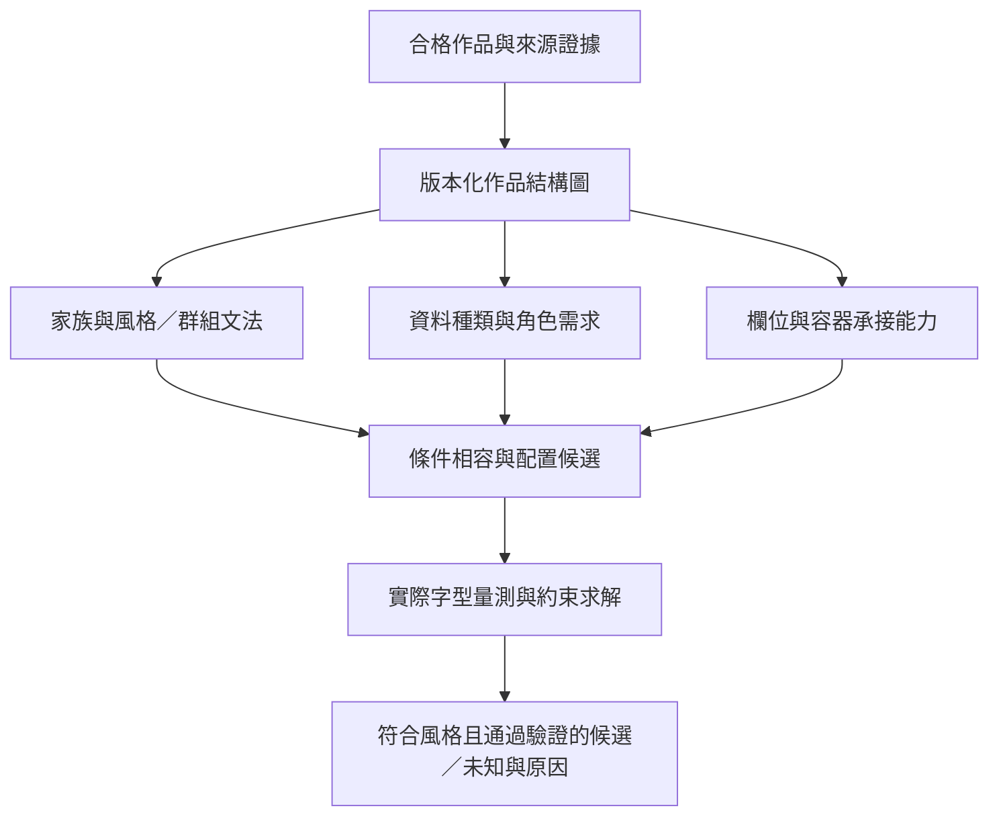

# Template AI：跨作品結構學習與條件生成綜合方案

2026-10-18｜**工程分析與建議稿，不是已訓練模型、已核准的新操作權限或功能完成證據。** 使用者要求全面分析，不限先前標籤固定／隨資料變動的A/B選項。聚焦本體的資料處理、模型、參數、訓練及驗證；互動設計待可檢查的訓練結果。

有效要求以[契約](AI_CROSS_WORK_LEARNING_CONTRACT.json)為準；對應[三項設計待辦](AI_TRAINING_DESIGN_TODOS.md)、[既有主計畫](AI_CROSS_WORK_LEARNING_PLAN.md)、[固定版本參考](AI_TRAINING_COMPREHENSIVE_REFERENCES.json)。三項待辦仍待完成正式schema、來源樣本對映與驗證設計；原8包50驗收仍0實作／0驗證。

## 1. 建議與適用原因

建議採用**共享階層結構圖＋資料需求／欄位能力兩個條件視角＋規則文法與實際排版驗證**。學習單位是跨作品的角色、關係、風格與變化，不是把每件作品另存為一張模板。兩個視角共用觀察與特徵，不預設一定需要兩套神經網路。

這符合本專案已有向量來源、毫米座標、固定字級政策、Qt字型量測、圖與約束求解器的條件。先用可追溯的結構／統計模型建立有效基準，再按真實失敗類型增加神經模型。數千件作品的價值取決於合格標記、字型／結構可恢復性、獨立設計家族與變體覆蓋，不能由檔案數直接保證。



這是建議架構，尚未實作。新欄位組合可由共享文法產生，結果再保存為可重用模板／規則版本；來源作品仍是證據，不是模板數量必須隨作品數線性增加的理由。

## 2. 根本修正：觀察、變化證據、允許變換分開

單張作品印有「TEL 02-…」，可以支持標籤與電話值的關係，通常不能證明TEL永遠固定或一定可以改成Email。不要只給一個`fixed=true/false`並要求它同時回答三個不同問題。

| 層次 | 要保存的資訊 | 證據與限制 |
|---|---|---|
| 觀察關係 | TEL標籤指向電話值、圖示對應角色、群組、實際位置 | 可由來源節點、字串、幾何與確認標記建立；可有歧義 |
| 變化規律 | 同系列哪些文字／圖示／位置隨資料或角色一起改變 | 需要跨作品、來源元件屬性或明確標記；單圖不足時UNKNOWN |
| 變換政策 | 哪些替換、重排、縮放與資產使用已允許 | 由有效規格與權利限制決定；學到相關性不等於獲得操作權限 |

因此可同時存在固定品牌字樣、隨資料變動的電話值、與類型綁定的標籤、同家族可選圖示、受限可重排容器及未知元素。三層可以逐步補齊，不必先把所有作品硬分成兩類。

例：若作品系列明確展示電話／Email／網址在同一種聯絡列中出現，且標籤隨類型改變，可學到該家族的`TypeMarker + Value`規則。若只有固定TEL的作品，仍可學到電話列幾何與風格，但不能聲稱它已支持Email替換。將Email塞入固定TEL後面，即使放得下也不合法。

## 3. 共享資料表示：語意、欄位與繪製物件不要混為一物

採用有型別的場景／關係圖；既有TrainingStore保存版本與來源，不新建平行資料庫。下列是建議schema草案，正式遷移仍屬待辦。

| 實體 | 主要欄位與型別 | 重要區別 |
|---|---|---|
| DesignObservation | observation_id、lineage_id、source_hash、split、qualification、size_mm、coordinate_transform、extractor_version | 合格狀態與每項來源證據分開，不用整件合格掩蓋未知字型 |
| SemanticFact | fact_id、type、subtype、role、owner_ref、raw_value_ref、normalized_value_ref、evidence_refs | 市話／手機、社群平台、地址角色可分層；原值與正規化值都保留 |
| VisualPrimitive／TextSpan | primitive_id、source_node_ref、span_range、ink_bounds_mm、font_asset_ref、source_pt、glyph_metrics、transform、visibility | 一個文字物件可包含多個語意span；OCR框不能當作原字級 |
| FieldRole | role_id、fact_refs、label_refs、icon_refs、owner_pattern、container_ref、relation_evidence | 一筆資料可印多次；一個顯示欄也可能由多段文字與圖示組成 |
| Group／Container | group_id、children、frame_mm、layout_direction、anchors、baseline_relations、gaps、flow、evidence | 框、墨跡範圍、可用空間分開；群組不是另一塊需要避開的印刷物 |
| Evidence | source_ref、method、status、uncertainty_reason、annotator_or_model_version | 缺失不是零、UNKNOWN不是負例；未校準分數不稱機率 |

圖邊至少包含`contains`、`renders_fact`、`label_of`、`icon_for`、`owned_by`、`aligned_to`、`baseline_with`、`precedes`、`gap_to`、`relative_to`與`shares_reference`。公司總機與個人分機可有引用關係，不能因位置靠近而改寫擁有者。整體公司／尺寸Logo仍受既有整體資產規則保護。

保留來源座標→頁面毫米→容器局部正規化座標的變換鏈。字級、水平縮放與來源仿射變換可能互相混淆；無可靠來源不能用框高反推唯一pt。碰撞只對應檢查的實際繪製物件與層執行，不能把包住子元素的容器框當成碰撞障礙。背景資產必須避免殘留舊個資文字。

## 4. 兩個條件視角與中間的關係模型

### 4.1 資料需求 DataRequirementProfile（TRAIN-DESIGN-01）

以`資料種類＋角色＋語系／書寫方向＋家族／風格＋實體尺寸＋實際字型／固定pt`為條件，學習該角色的需求與可接受呈現模式。姓名、職稱、手機、總機、Email、社群ID、地址等使用同一套表示，但不強迫共用同一風格參數。

- 儲存字數、字素群數、文字腳本、實際塑形advance／墨跡範圍／基線／行高、斷行與不可分割片段證據。
- 儲存角色層級、對齊、間距／分散方式、來源字型與字級分布；不同家族保留多種模式。
- 原始字串只用於必要的語意辨識與字型量測，不讓人名、客戶ID或公司名稱成為家族辨識捷徑；查證來源的私有引用保留本地。
- 實際字串進來時重新量測，不能用平均字寬或字數上限取代。相同字數的`WWW`與`iii`需要不同空間；中英混排、組合字與RTL也要依實際字型塑形。

字型已知時可精確量測該字型的渲染；字型未知時保留部分可觀察的幾何與語意，不能把目前預設Noto／10pt補成訓練真值。

### 4.2 欄位能力 FieldCapabilityProfile（TRAIN-DESIGN-02）

以容器／角色為主體，學習它在特定家族、尺寸、資產、固定字級與政策下能承接什麼，以及會如何牽動周圍結構。

- 幾何：容器範圍、錨點、實際基線、對齊關係、欄間距、順序與相對位移；絕對mm和正規化座標同時保留。
- 承接：已支持的角色／資料種類、主人條件、標籤與圖示對應、必要／可省略條件、允許的群組組合。
- 容量：邏輯資料筆數、渲染實例數、聯合字寬／高度需求、占位率、角色層級與字型條件；不是一個全域`max_chars`。
- 變化：有證據的分割／合併、可重複聯絡列、群組排列、標籤變體、位置變體；每種都帶來源與適用條件。

「同一筆公司電話印在兩面」是一次資料、兩次占位；「一列含電話與分機」是多筆關聯資料，不必等同兩個可自由交換的框。框大小相同不代表語意、主人、標籤或容量相同。

### 4.3 相容、等效與替代（TRAIN-DESIGN-03）

設資料需求為D、欄位能力為F、上下文為c。建議輸出`match(D,F|c)`，其中**證據狀態、政策狀態、實際可行性是三個獨立欄位**：

| 輸出 | 建議值 | 用途 |
|---|---|---|
| evidence_status | SUPPORTED／CONTRADICTED／UNKNOWN | 是否有對應條件的來源支持 |
| policy_status | ALLOWED／FORBIDDEN／UNKNOWN | 目前是否允許執行 |
| feasibility_status | VERIFIED_FEASIBLE／VERIFIED_INFEASIBLE／NOT_EVALUATED／UNKNOWN | 該次實際字串與完整布局的量測／求解結果 |
| applicability | family、role、owner、font、pt、size、marker、assets、version | 防止條件被省略 |
| trace | source_refs、reason_codes、support_lineages、model_version、solver_version | 可還原、可測試與可更新 |

SUPPORTED不表示可執行；ALLOWED也不保證本次字串放得下。新組合可透過已學文法與批准政策產生，再驗證可行性，但不得把合成結果回寫為「來源已觀察的合格風格」。

同類共通規則用於統計共享與少樣本學習，例如同家族各個聯絡列的基線／間距規則。嚴格等效群必須具有相同的角色與條件簽章；近似聚類只能作候選，不能直接授予交換權限。跨類替代另存**有方向的條件關係**：A能承接B，不保證反向或可傳遞。兩欄互換需同時驗證兩個目的地的綁定與整體相鄰布局，不能只做兩次框大小比較。

## 5. 學習分割、對齊、字級、字寬與分散的因果鏈

建議以此鏈條聯合建模，而非把每個值獨立取平均：

`角色／分組 → 欄位分割與排列 → 可用容器及對齊錨點 → 實際文字占位 → 字寬／間距／風格相容 → 群組與整體可行性`

這是生成與約束依賴，不宣稱從觀察資料已識別真正的因果效應。文字／圖示證據也會反向修正群組判斷；不同分割假設可保留候選，再利用整體一致性排除。

具體學習量：

1. **分割與組合**：來源父子節點、空白分界、基線群、標籤關係和閱讀順序共同估計群組；保存候選及歧義，不以單一距離閾值硬切。跨作品學出可選節點、重複列與分割／合併文法。
2. **對齊與相對位置**：在容器局部座標比較左／右／中心錨點、基線差、間隙及寬高比例。以具尺度的容差和穩健殘差找共通關係；同基線與框頂齊是不同特徵。
3. **字級風格**：學角色間的來源字級層級及適用尺寸／家族。來源pt必須可靠。執行仍依核准角色／設計／實體尺寸選定後凍結，不因字串較長換小pt，也不藉挑較小字級候選繞過政策。
4. **字寬與字距**：先量測實際字型的原生advance，區分字形水平縮放、tracking、字間分散、詞間分散與物件間gap。相同視覺總寬可能由不同機制產生，單圖不可唯一辨識時保留未知。
5. **分散風格**：區分分散作用於何種角色／字素／詞／列，是否固定兩端、單字例外與群組共同對齊。可觀察到新模式，但啟用仍受既有title/address分散與tracking政策限制。

對已知塑形與合法分散點，可用幾何關係檢查假設：`W = sx × Σadvance + (n−1)t + Σextra_gap`。n是參與該分散策略的單位數，不能把Unicode codepoint數直接代入；混合字型／run與字距單位也要明確。此式用來區分可識別參數與歧義，不授權反算任意縮放或變更pt。

局部位置可表示為`u=(x−container_x)/container_width`、`v=(y−container_y)/container_height`，同時保留原mm及基線證據。左右錨點、等間距和相對比率可用中位數／MAD及有條件回歸建模；零尺寸／未知容器不可進行此正規化。

## 6. 文法與模板生成：共享規則，而非固定框集合

以下是**示意、未訓練的文法**，不代表已支持任何跨類替換：

```text
DesignFamily -> BrandGroup + PersonGroup + ContactGroup + optional(OtherGroup)
ContactGroup -> bounded_repeat(ContactItem, conditional_capacity_profile)
ContactItem  -> optional(TypeMarker) + Value + optional(Auxiliary)
TypeMarker   -> supported_label_or_icon(type, role, family, assets, policy)
```

`optional`只在對應資料確實不存在且規則支持時省略；不能為了塞得下而刪除輸入內容。`bounded_repeat`承接全部相關資料，個數受聯合容量與實際驗證限制。來源沒有辨識到某元素，不等於證明該元素可以省略。

模板應保存「家族＋角色圖＋可變文法＋條件風格參數＋資產／政策＋模型版本」。先選合法結構、標籤與對齊拓撲，再交給既有線性約束引擎求位置。Cassowary不負責憑空選出所有非凸結構；拆／併欄與多行等離散變體必須由有證據的文法枚舉，再各自量測與驗證。多行是受條件的布局能力，不重新開放已撤回的客戶單／雙排控制。

## 7. 建議訓練管線與演算法分工

| 階段 | 首版做法與重用 | 學到／產出的資訊 | 主要限制 |
|---|---|---|---|
| 來源觀察 | 既有Inkscape／SVG解析、Qt／fontTools、來源hash | 幾何、實際文字度量、來源字型證據與UNKNOWN | 點陣／外框字可輔以OCR；OCR／VLM不是原始字型與pt真值 |
| 語意與群組 | 既有規則＋字元ngram基準，加入標籤／容器／基線上下文 | 資料類別、span、主人、label/value/icon與群組邊 | 先有可靠標記與分層類別，不用private值記憶角色 |
| 家族／風格 | 結構特徵與缺失遮罩；HDBSCAN作候選，人工／標記校準 | 多密度家族、風格子模式、支持與孤立樣本 | noise不等於不合格；罕見合格風格保留，不強併 |
| 條件參數 | 中位數／MAD、低複雜度條件回歸；條件足夠再試RANSAC | 錨點、gap、相對比例、角色度量分布 | RANSAC內點閾值不是容量邊界或可信區間 |
| 綁定與變化 | 先以可追溯規則／小型結構或表格模型，使用跨作品變體與確認關係 | 標籤／圖示關係、可選／重複結構、條件替代候選 | UNKNOWN不作負例；單圖推不出編輯權限 |
| 條件生成 | 有限文法候選＋NetworkX關係＋Kiwi/Cassowary；實際Qt塑形 | 可重用規則模板與新資料組合的布局候選 | 量測與渲染使用同一字型／字形位置；正式Gate另驗 |
| 適配排序 | 初期明確分量評分；有真實比較資料後才試CatBoost PairLogit | 家族／候選相對偏好與原因 | 合格作品只有正例，不能自行製造「更喜歡A」標籤 |
| 強模型擴充 | 基準證明有缺口後，評估圖編碼器／Transformer／LayoutDM類條件生成 | 較複雜關係與跨家族泛化 | 資料、授權、算力、現有棧適配與獨立增益需先證明 |

若引入多任務模型，可共享編碼器，分別預測語意角色、關係、家族與度量；未有標記的任務使用mask，不把缺失當負例。遮罩還原／對比等自監督可改善表示，但不直接產生合格判定或跨類允許標記。首版不必等待大模型訓練，現有開源演算法即可建立可學習、可比較的端到端基準。

可用有政策的反事實替換測試字長、筆數、標籤及主人錯配，產生技術可行／不可行的訓練或壓力案例；**這些合成結果不是美感真值、不是獨立測試，也不是新來源證據。** 自動特徵發現只能提出版本化候選，不能自行改寫正式欄位權限或核准政策。

## 8. 參數應分四類管理

| 類別 | 例子 | 更新來源 |
|---|---|---|
| 來源量測 | mm、字型hash、來源pt／transform、基線、實際advance、墨跡框 | 來源／量測器版本；修正需保留歷史 |
| 可學參數 | 家族、角色條件分布、錨點／gap、分散模式、群組文法、綁定／替代證據、聯合容量 | 合格TRAIN及具來源標記；模型版本與適用範圍 |
| 硬政策 | 主人／語意不失真、固定pt、Logo／字型／來源權利、允許縮放與分散、正式Gate | 已核准規格；訓練不能覆蓋 |
| 訓練／搜尋超參數 | 聚類權重、最小支持、正則化、候選預算、容差、拒答閾值 | VALIDATION選擇並保存；不是從作品自動得出的設計真理 |

既有Slot的`min_scale=.85`不是學到的全域最佳值，原型70%／歷史65%亦不能直接搬成統一界線。可保留來源中負tracking等觀察，但現行執行政策仍禁止時必須清楚標記衝突。新增參數優先補足**綁定、群組、條件與證據**，而不是無目的增加成百上千個調整旋鈕。

字級縮放風格可以作為來源設計的學習對象；若跨作品可辨識尺寸條件下的角色字級關係，可提出規則候選。這與「輸入太長時自動縮小字級」不同，後者不在目前政策內。模型足夠強也不能消除有限紙面與固定字型度量的物理限制。

## 9. 合格風格區域與聯合容量

沿用使用者定義：**訓練資料裡合格作品呈現的風格特徵，構成適合區間的證據。** 應學`S(family,size,roles,font,pt,assets,policy)`的條件／聯合／多模態區域，不是將所有作品平均成一個風格，也不是每個參數各自取min/max後拼成矩形。

- `observed`：實際出現過的組合、來源與獨立lineage支持數。
- `recommended`：模型估計符合該風格的區域，附覆蓋範圍／支持／未知；不能無聲刪除低頻合格風格。
- `validated_admission`：在指定版本、條件和驗證範圍內可供後續限制／引導使用的profile。現在不討論其介面，也尚無數值。

容量輸入是角色組合、資料筆數及各文字的實際占位向量。每欄各自能放最大值，不代表同時可放；共享字串多次印出仍分別占位。測試應同時改變長度、混排、數量、群組與標籤占位，而不是只抽最長字串。

最大訓練筆數只是觀察上界。可以在給定文法與搜尋預算內探索擴展，但得到的是「已找到／已驗證範圍」，不是所有設計的數學最大值。離散換列／重組後可行性未必隨筆數單調，沒有證明不能直接用二分搜尋；超時與超出支持範圍回報UNKNOWN，不能當不可行或已保證可用。

## 10. 參照取捨：直接重用與保留研究方向

本輪實際讀取8份固定版本公開文件，6份內容hash符合前輪來源，另核對Qt6.8.3標籤及2份公開文字布局來源。完整URL、commit、SHA256、閱讀段落及授權範圍見[參考清單](AI_TRAINING_COMPREHENSIVE_REFERENCES.json)與[研究紀錄](../qa/plans/COMPREHENSIVE-TRAINING-RESEARCH-20261018.json)。未下載模型權重、未安裝新依賴、未使用付費推論服務。

| 來源 | 借鑑／重用 | 不能據此聲稱的能力 |
|---|---|---|
| Figma公開Plugin API／Auto Layout／元件屬性，MIT typings | 容器、對齊、尺寸模式、元件屬性與標籤綁定表示 | 未取得商用私有AI訓練方法；資料schema不等於已完成學習 |
| Qt6.8.3 QTextLayout／QGlyphRun | 使用既有公開API取得塑形後glyph、位置、字串索引、基線／布局；與渲染共用 | 不從點陣圖片恢復唯一原字型；不複製Qt私有引擎 |
| scikit-learn1.7.2 HDBSCAN／RANSAC，BSD-3-Clause | 家族候選、噪聲／缺失分析、條件穩健擬合 | 不把noise判成壞作品；不把內點閾值當泛化保證 |
| Kiwi1.4.9，BSD-3-Clause | 重用已安裝Cassowary線性約束，不另寫求解器 | 不代替非凸文法選擇、實際字型量測或正式印前驗證 |
| LayoutDM固定commit，Apache-2.0程式 | 借鑑partial／relation／refinement等條件生成任務 | 舊PyTorch棧不能直接當本專案正式引擎；資料／權重授權另核 |
| 既有CatBoost1.2.8排名參考 | 有真實偏好資料後才比較PairLogit／查詢群組 | 合格正例不自動等於成對偏好；本輪未訓練 |

NetworkX3.5、fontTools4.60.1、SQLite TrainingStore與Inkscape延用原架構。先前Adobe來源未能讀取的紀錄仍標NOT_READ，不作本方案已驗證依據。Qt依現有授權方式使用公開API；參考或程式的授權不能推論私人設計、字型、資料集或權重也可使用。

與三種常見替代方案相比：逐件複製框無法形成跨作品學習；直接讓VLM輸出座標容易缺失主人、字型與政策證據；一開始端到端訓練擴散模型成本高且仍需排版驗證。本方案先解決可識別的結構與度量，留下日後更強編碼器的替換界面。代價是來源解析、部分關係標記與資料治理要先做好；不能承諾任意圖片無人工審查即可恢復完整設計意圖。

## 11. 驗證設計：證明泛化與可執行性，避免自證

先依原始設計／系列／近重複lineage分組，再拆TRAIN、VALIDATION及封存TEST。成對修訂版本不能跨集合；大量近重複作品不能增加獨立支持數。測試曝光後不能繼續當封存測試反覆調參。

比較基準至少有：原逐件模板、只看資料種類、只看欄位幾何、完整結構／綁定模型。比較未見過的資料組合與變體上的角色／關係正確率、覆蓋／拒答、風格保留、硬規則錯誤、可行性、修正成本、模板數及維護成本。模板壓縮率不能獨自當成功指標。

必要反例：固定TEL承接Email；同類資料不同家族／角色；同框不同主人；跨類替代不對稱／不可傳遞；兩端可放但交換破壞相鄰群組；共享電話多處印出；單欄最大值聯合失敗；罕見合格風格；相同字數不同實際寬度；未知字型被誤補10pt；容器框誤判碰撞；背景殘留舊個資；量測與渲染不一致；來源未觀察不等於可省略。

分別報告資料／關係標記品質、綁定／角色判斷、風格覆蓋、技術布局驗證與獨立實作品質，不用求解器產生的合成標籤自證美感正確。人工確認／真實來源關係才能校驗相容性；有真實比較才評排名。未知字型與資產權限不足等阻擋另報，不從分母靜默剔除。

目前無可據以宣稱全面模型效能的已核准實際語料驗證。主計畫既有樣本量、ARI、可行率、Top-k與效能數字仍為工程提案，不因本分析變成實測結果或承諾。

## 12. 落地順序與第一個可檢查成果

1. **觀察／schema層**：完成三項TODO的typed schema、UNKNOWN／單位、來源標記規範、既有Slot／TrainingStore相容遷移、實際樣本對映與測試計畫。先不重寫前端。
2. **跨作品最小閉環**：實作AI01來源結構圖→AI02家族／風格→AI03資料需求／欄位能力／綁定文法→AI04條件生成與實際量測／求解。產物必須包含新組合，不能只輸出來源逐件複本。
3. **資料驗證與迭代**：以獨立實作／lineage評估、反例、條件容量與UNKNOWN報告定位缺口；依支持度擴充規則／資料或編碼器，不先堆模型規模。
4. **偏好與版本生命週期**：AI05／06在有真實比較時訓練排序，保存資料、參數、模型、資產／政策、失敗原因及回退版本；AI08核心評估不等待AI07互動。
5. **結果之後**：再依實測模型輸出恢復本體互動設計。獨立網頁／手機端繼續延後，不重新加入已撤回控制。

第一個成果應是一組可重現的**跨作品規則包＋兩個profile＋條件匹配追溯＋未見資料組合布局＋獨立驗證報告**。例如從合格聯絡群組學到標籤／值／間距與可重複規則，在新資料組合上生成合法候選並說明條件／未知，而不是展示匯入幾張就新增幾張模板。

正式規則包應記錄`observation/schema/model/policy/font/assets/solver`版本、訓練lineage、參數與搜尋預算、適用條件、輸出及驗證結果；接續工作讀取GitHub提交和交接檔即可，不靠完整聊天。私人原稿、字型、個資以本地受控引用保存，GitHub僅保存可公開的程式、規格及去識別證據。

## 13. 尚待完成的設計事項

- 三項TODO各自的正式schema／遷移與gold標記規範，及其在實際來源樣本的可恢復性。
- 合格TRAIN語料／系列關係與實際字型資產可用性；未回答的訪談問題不推定已有資料。
- 類別細分、跨類適用簽章、最小支持、缺失距離與訓練超參數的驗證選擇。
- 跨家族與稀有風格驗證集合、技術與實作品質分開的驗收閾值；不預先捏造最佳數值。

本分析提供推薦架構及理由，沒有啟動訓練或宣告三項設計已完成；相關待辦與原驗收計數保持不變。
